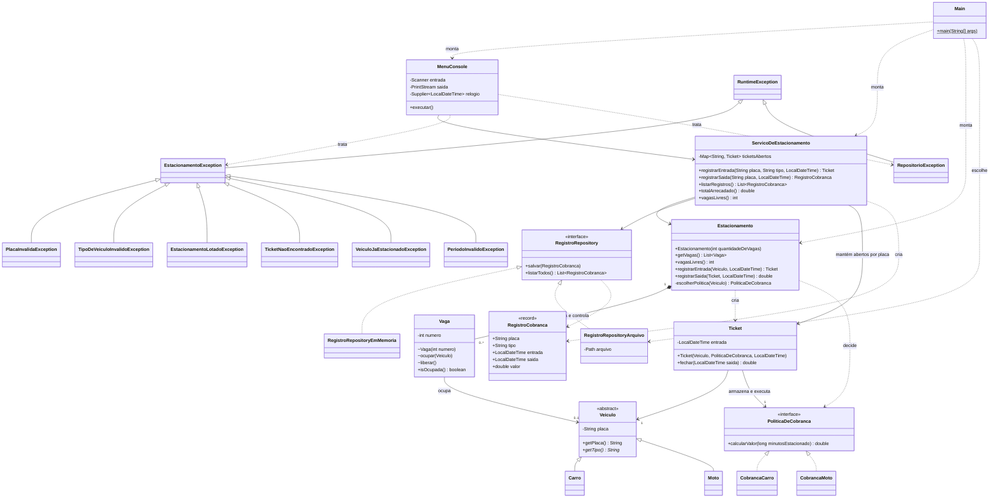
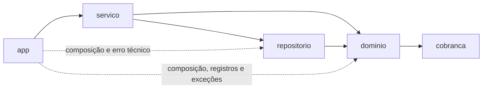

# Diagramas — estado v13

Os diagramas abaixo representam o código atual. A imagem `diagrama.png` foi preservada como material anterior; sua alteração local não faz parte da atualização dos encontros 11 a 13.

## Classes

## Dependências entre pacotes

As setas indicam dependências de código. O domínio não conhece o repositório; o serviço coordena os dois. A apresentação também conhece os tipos necessários para compor a aplicação e tratar erros.