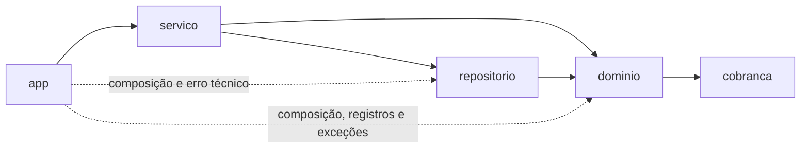

# Diagramas — estado v14

Os diagramas Mermaid representam as classes de produção e suas dependências. A [imagem fornecida pela professora](diagrama.png) continua como registro do núcleo do Encontro 11. A exportação do Lucid não é gerada por esta atualização.

## Classes

```mermaid
classDiagram
    class Veiculo {
        <<abstract>>
        -String FORMATO_PLACA$
        -String placa
        #Veiculo(String placa)
        +normalizarPlaca(String placa) String$
        +normalizarTipo(String tipo) String$
        +getPlaca() String
        +getTipo() String*
    }
    class Carro {
        +String TIPO$
        +Carro(String placa)
        +getTipo() String
    }
    class Moto {
        +String TIPO$
        +Moto(String placa)
        +getTipo() String
    }
    Veiculo <|-- Carro
    Veiculo <|-- Moto

    class PoliticaDeCobranca {
        <<interface>>
        +calcularValor(long minutosEstacionado) double
    }
    class CobrancaCarro {
        -double TARIFA_MINUTO$
        +calcularValor(long minutosEstacionado) double
    }
    class CobrancaMoto {
        -double TARIFA_MINUTO$
        +calcularValor(long minutosEstacionado) double
    }
    PoliticaDeCobranca <|.. CobrancaCarro
    PoliticaDeCobranca <|.. CobrancaMoto

    class Ticket {
        -Veiculo veiculo
        -PoliticaDeCobranca politica
        -LocalDateTime entrada
        +Ticket(Veiculo veiculo, PoliticaDeCobranca politica, LocalDateTime entrada)
        +fechar(LocalDateTime saida) double
        +getVeiculo() Veiculo
        +getEntrada() LocalDateTime
    }
    Ticket --> "1" Veiculo
    Ticket --> "1" PoliticaDeCobranca : armazena e executa

    class Vaga {
        -int numero
        -Veiculo veiculo
        ~Vaga(int numero)
        +getNumero() int
        +getVeiculo() Veiculo
        +isOcupada() boolean
        ~ocupar(Veiculo veiculo) void
        ~liberar() void
    }
    class Estacionamento {
        -List~Vaga~ vagas
        +Estacionamento(int quantidadeDeVagas)
        +getVagas() List~Vaga~
        +vagasLivres() int
        +registrarEntrada(Veiculo veiculo, LocalDateTime entrada) Ticket
        +registrarSaida(Ticket ticket, LocalDateTime saida) double
        +calcularValorDaSaida(Ticket ticket, LocalDateTime saida) double
        +liberarVaga(Ticket ticket) void
        -buscarVagaLivre() Vaga
        -escolherPolitica(Veiculo veiculo) PoliticaDeCobranca
    }
    Estacionamento "1" *-- "0..*" Vaga : cria e controla
    Vaga --> "0..1" Veiculo : ocupação
    Estacionamento ..> Ticket : cria e valida
    Estacionamento ..> PoliticaDeCobranca : decide
    Estacionamento ..> CobrancaCarro : instancia
    Estacionamento ..> CobrancaMoto : instancia

    class RegistroCobranca {
        <<record>>
        +String placa
        +String tipo
        +LocalDateTime entrada
        +LocalDateTime saida
        +double valor
    }
    class RegistroRepository {
        <<interface>>
        +salvar(RegistroCobranca registro) void
        +listarTodos() List~RegistroCobranca~
    }
    class RegistroRepositoryEmMemoria {
        -List~RegistroCobranca~ registros
        +salvar(RegistroCobranca registro) void
        +listarTodos() List~RegistroCobranca~
    }
    class RegistroRepositoryArquivo {
        -Path arquivo
        +RegistroRepositoryArquivo(Path arquivo)
        +salvar(RegistroCobranca registro) void
        +listarTodos() List~RegistroCobranca~
        -converter(String linha) RegistroCobranca
    }
    RegistroRepository <|.. RegistroRepositoryEmMemoria
    RegistroRepository <|.. RegistroRepositoryArquivo
    RegistroRepository ..> RegistroCobranca

    class ServicoDeEstacionamento {
        -Estacionamento estacionamento
        -RegistroRepository repositorio
        -Map ticketsAbertos
        +ServicoDeEstacionamento(Estacionamento estacionamento, RegistroRepository repositorio)
        +registrarEntrada(String placa, String tipo, LocalDateTime entrada) Ticket
        +registrarSaida(String placa, LocalDateTime saida) RegistroCobranca
        +listarRegistros() List~RegistroCobranca~
        +totalArrecadado() double
        +vagasLivres() int
        -criarVeiculo(String placa, String tipo) Veiculo
    }
    ServicoDeEstacionamento --> Estacionamento
    ServicoDeEstacionamento --> RegistroRepository
    ServicoDeEstacionamento --> Ticket : mantém por placa
    ServicoDeEstacionamento ..> RegistroCobranca : cria
    ServicoDeEstacionamento ..> Carro : cria
    ServicoDeEstacionamento ..> Moto : cria

    class MenuConsole {
        -ServicoDeEstacionamento servico
        -Scanner entrada
        -PrintStream saida
        -Supplier~LocalDateTime~ relogio
        +MenuConsole(ServicoDeEstacionamento servico, Scanner entrada, PrintStream saida, Supplier~LocalDateTime~ relogio)
        +executar() void
        -tratar(String opcao) boolean
        -registrarEntrada() void
        -registrarSaida() void
        -listarRegistros() void
        -mostrarMenu() void
    }
    MenuConsole --> ServicoDeEstacionamento
    class Main {
        +main(String[] args) void$
    }
    Main ..> MenuConsole : monta
    Main ..> ServicoDeEstacionamento : monta
    Main ..> Estacionamento : monta
    Main ..> RegistroRepositoryArquivo : escolhe

    class EstacionamentoException {
        +EstacionamentoException(String mensagem)
    }
    class PlacaInvalidaException {
        +PlacaInvalidaException(String placa)
    }
    class TipoDeVeiculoInvalidoException {
        +TipoDeVeiculoInvalidoException(String tipo)
    }
    class EstacionamentoLotadoException {
        +EstacionamentoLotadoException()
    }
    class TicketNaoEncontradoException {
        +TicketNaoEncontradoException(String placa)
    }
    class VeiculoJaEstacionadoException {
        +VeiculoJaEstacionadoException(String placa)
    }
    class PeriodoInvalidoException {
        +PeriodoInvalidoException()
    }
    class RepositorioException {
        +RepositorioException(String mensagem, Throwable causa)
        +RepositorioException(String mensagem)
    }
    RuntimeException <|-- EstacionamentoException
    EstacionamentoException <|-- PlacaInvalidaException
    EstacionamentoException <|-- TipoDeVeiculoInvalidoException
    EstacionamentoException <|-- EstacionamentoLotadoException
    EstacionamentoException <|-- TicketNaoEncontradoException
    EstacionamentoException <|-- VeiculoJaEstacionadoException
    EstacionamentoException <|-- PeriodoInvalidoException
    RuntimeException <|-- RepositorioException
    MenuConsole ..> EstacionamentoException : trata
    MenuConsole ..> RepositorioException : trata
    RegistroRepositoryArquivo ..> RepositorioException : lança
```

`ticketsAbertos` associa placas (`String`) a `Ticket`. A operação `Ticket.fechar` apenas calcula o valor; o serviço salva o registro antes de pedir `Estacionamento.liberarVaga` e remover o ticket. Os campos do record representam seus componentes, acessíveis pelos métodos gerados `placa()`, `tipo()`, `entrada()`, `saida()` e `valor()`.

## Dependências entre pacotes

As setas indicam dependências de código. O domínio não importa `repositorio`. As dependências adicionais de `app` permitem montar os objetos e apresentar registros e erros.